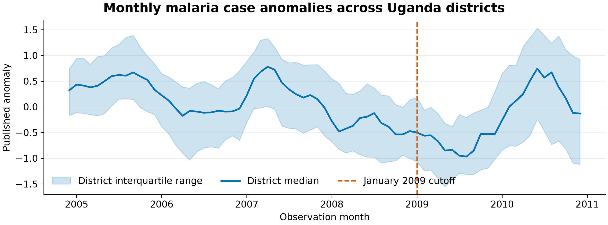
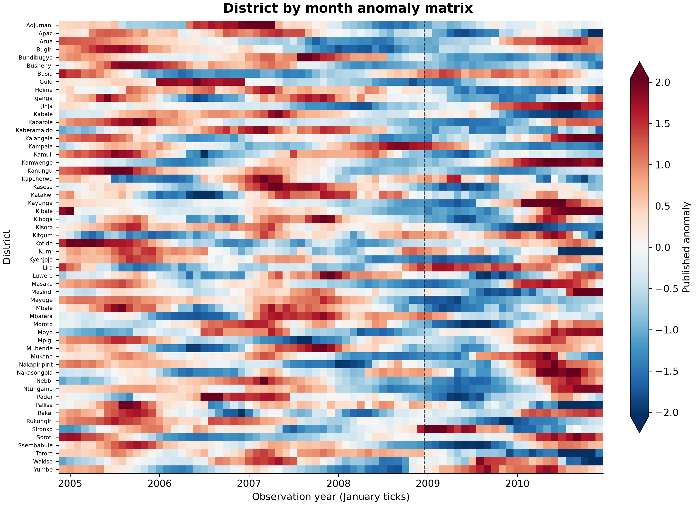
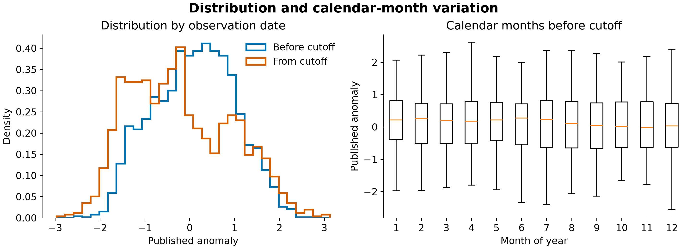
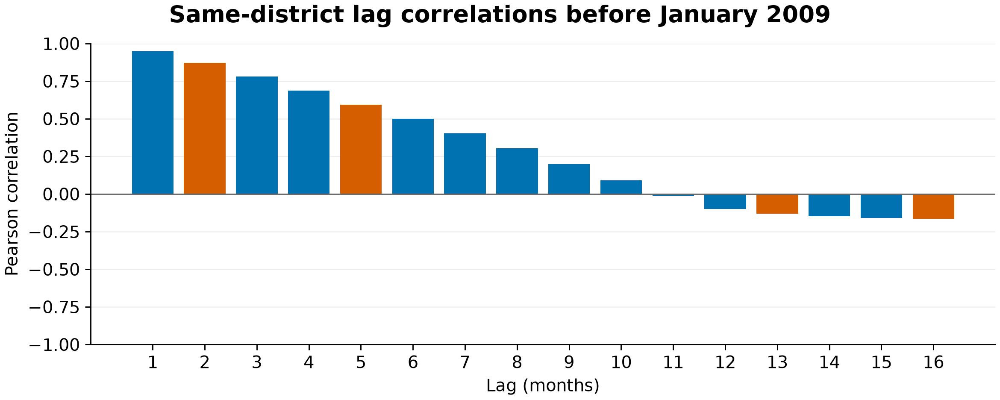
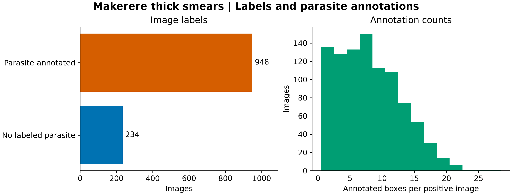
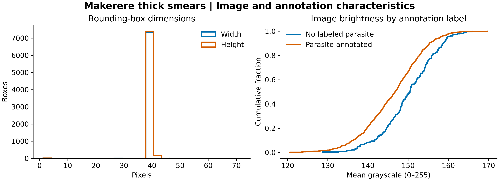

# Exploratory data analysis

This analysis covers the two real archives used by the repository. It describes source coverage and data quality separately from the model results in [REPORT.md](REPORT.md). District-months and microscope images are the units of analysis.

## PANGAEA | Uganda district case anomalies

The archive provides a complete **56-district by 73-month** panel from December 2004 through December 2010, with **4,088 distinct district-month observations** and no missing cells. The observed anomaly repeats across four forecast-lead rows. The analysis keeps one copy per district-month and excludes the ensemble forecasts. Values range from −2.968 to 3.126 in the publisher's anomaly units. [Tompkins et al., PANGAEA supplement 2](https://doi.pangaea.de/10.1594/PANGAEA.897624)



*Figure E1. The line shows the median across 56 districts each month. The band spans the 25th to 75th percentiles, and the dashed line marks the January 2009 evaluation cutoff.*



*Figure E2. Rows are districts in alphabetical order. Colors use a symmetric scale around zero and saturate beyond the 98th percentile of absolute anomalies. Districts differ in the timing and direction of their changes.*

| Observation period | District-months | Median anomaly |
| --- | ---: | ---: |
| Before January 2009 | 2,744 | 0.147 |
| January 2009 onward | 1,344 | −0.327 |

These counts describe the source periods. The training and test sets in the forecast experiment are smaller because the model needs complete lag history and drops rows that cross the cutoff.



*Figure E3. The left panel compares distributions using common bins and density normalization. The right panel groups pre-cutoff observations by calendar month and omits plotted outliers for legibility. The median was lower after the cutoff.*



*Figure E4. Each correlation pools pairs of observations from the same district, with both months before January 2009. Orange marks the target-relative lags used by the forecast experiments. The latest available anomaly is two months behind the one-month target and five months behind the four-month target because the input excludes the issue month.*

The two- and five-month correlations were **0.871** and **0.593**, respectively. The older model inputs at lags 13 and 16 had correlations of **−0.131** and **−0.165**. The short-lag dependence explains why persistence is an informative comparator. These are pooled descriptive correlations in a published normalized series. They provide no estimate of out-of-sample forecast skill or performance in new districts.

## Makerere | Smartphone thick-smear microscopy

The archive contains **1,182 JPEG/XML pairs**, all 750 × 750 pixels and all annotated as originating from Mulago National Referral Hospital. **948 images (80.2%)** have a parasite annotation and **234 (19.8%)** have no labeled parasite. These are image annotation categories. The archive contains no verified slide or patient mapping. [Makerere phone-camera archive](https://air.ug/downloads/plasmodium-phonecamera.zip)



*Figure E5. The 948 images with annotations contain 7,628 boxes. The median positive image has eight boxes, and the maximum is 27.*



*Figure E6. Box widths and heights concentrate near 40 pixels. The right panel compares the cumulative distributions of mean grayscale intensity per image.*

Median width and height were both **40 pixels**. **408 of 7,628 boxes (5.3%)** extended beyond at least one image edge, and none had zero or negative width or height. Any localization preprocessing should check boundary handling. Median image brightness was **146.8** in images with a parasite annotation and **150.4** in images without one on a 0–255 grayscale. The distributions overlap, and the observed difference identifies a possible shortcut for an image classifier. It does not establish a cause or predict how a classifier will behave on a grouped holdout.

## Reproduce the figures

Use the public archives in the local `data/` folder. The commands write six PNGs, six SVGs, and an aggregate `summary.json` with counts and archive SHA-256 hashes.

```powershell
python -m pip install -r requirements-plots.txt
python explore_datasets.py --pangaea data/pangaea.zip --makerere data/phonecamera.zip --out runs/eda
```
