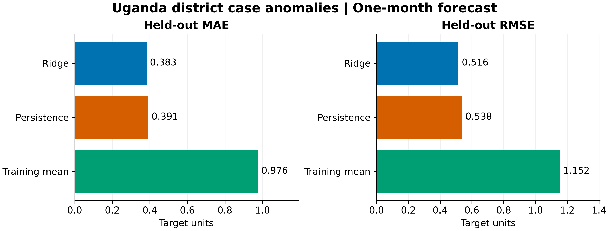
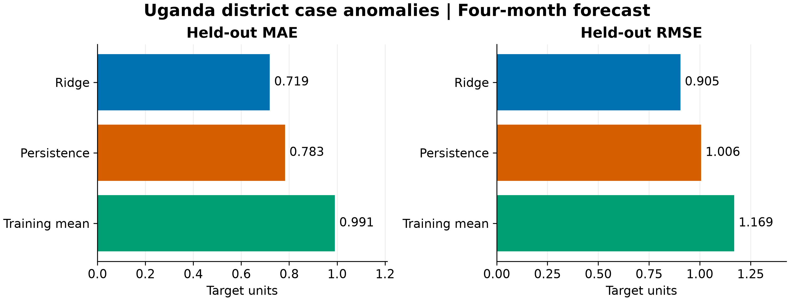
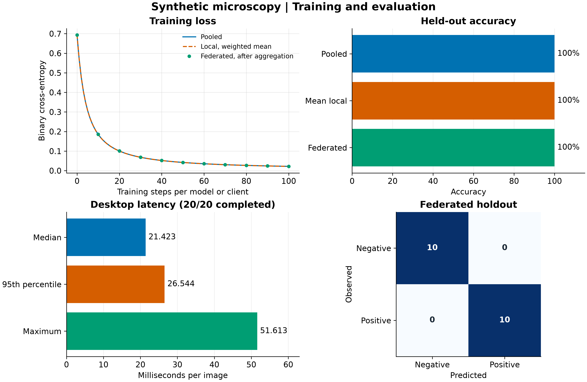
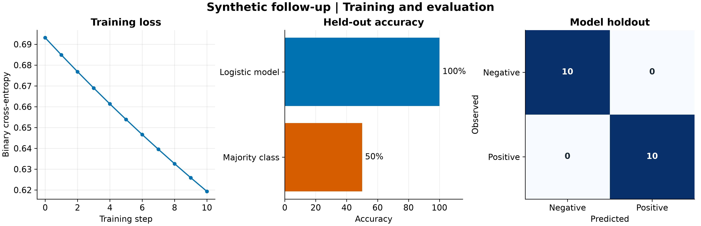
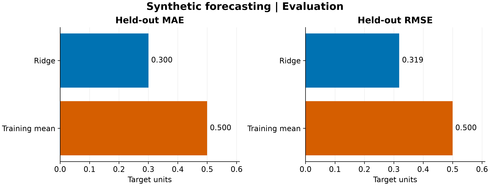
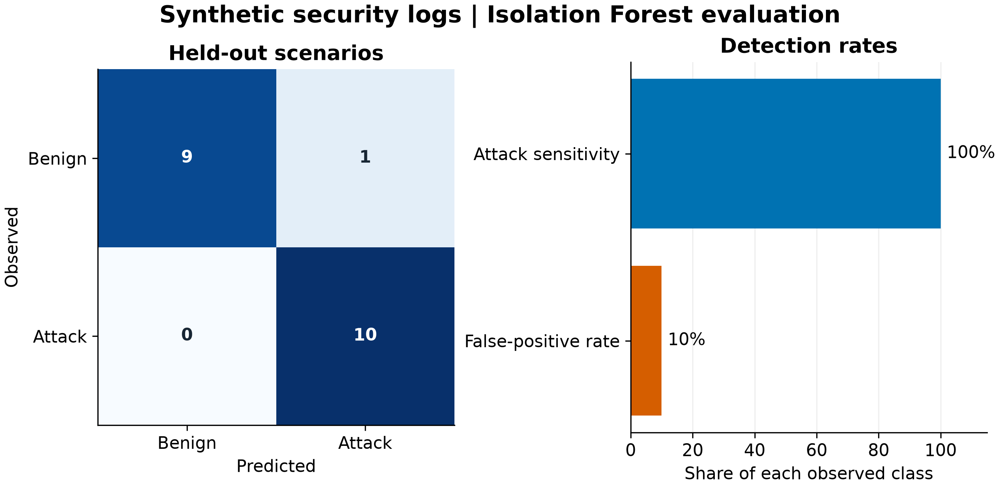

# Malaria forecasting and trainer evaluation

## Main result: historical Uganda forecasts

We evaluated one- and four-month forecasts of monthly malaria case anomalies in 56 Ugandan districts. The ridge model used the previous month's and year-ago anomalies relative to each forecast date. Training outcomes preceded January 2009. Test forecast dates began in January 2009, and rows whose training outcomes would have crossed the cutoff were omitted. Persistence predicted the most recent anomaly available in the input, and the training mean provided a constant baseline. [PANGAEA source and attribution](https://doi.pangaea.de/10.1594/PANGAEA.897624)

| Horizon | Train / test district-months | Ridge MAE / RMSE | Persistence MAE / RMSE | Training mean MAE / RMSE | MAE reduction vs persistence |
| --- | ---: | ---: | ---: | ---: | ---: |
| 1 month | 2,016 / 1,288 | 0.383 / 0.516 | 0.391 / 0.538 | 0.976 / 1.152 | 2.1% |
| 4 months | 1,848 / 1,120 | 0.719 / 0.905 | 0.783 / 1.006 | 0.991 / 1.169 | 8.1% |

**Suggested paper wording.** In a retrospective holdout covering 56 Ugandan districts, ridge regression yielded MAE of 0.383 at one month and 0.719 at four months, versus 0.391 and 0.783 for persistence, respectively. Errors are in the publisher's anomaly units. The holdout measures later months in districts seen during training. The input series was normalized by the publisher, and historical release timestamps are unavailable. The study did not estimate uncertainty or evaluate official outbreak alerts.

*Figure 1. One-month forecast errors on 1,288 held-out district-months. Lower is better.*

*Figure 2. Four-month forecast errors on 1,120 held-out district-months. The horizons use different eligible rows.*

For a presentation, use Figures 1 and 2 together and report the 2.1% and 8.1% MAE reductions relative to persistence. Label the outcome “historical malaria case anomaly.”

## Training loss and synthetic checks

Training loss is mean binary cross-entropy on training examples, excluding the L2 penalty. The curves include initialization. For diagnostics, local loss averages each client's own training loss weighted by its sample count. Pooled and federated losses evaluate their model on all training examples. Federated points mark aggregation rounds, at 10 local updates per round. Ridge solves a linear system once, and Isolation Forest fits trees without an epoch loss. Their charts show held-out metrics.

*Figure 3. Synthetic microscopy pipeline. With 60 training and 20 test images, pooled, local and federated accuracy all reached 100%. The federated gain was zero percentage points. Federated training loss fell from 0.693 to 0.022 after 10 rounds. All 20 requests completed. Latency reflects a single Windows desktop run on generated images.*

*Figure 4. Synthetic follow-up pipeline. Training loss fell from 0.693 to 0.619 over 10 updates. Test accuracy was 100% versus 50% for the majority baseline on 20 generated examples.*

*Figure 5. Synthetic forecast pipeline. Ridge MAE and RMSE were 0.300 and 0.319, respectively, versus 0.500 for both under the training mean.*

*Figure 6. Synthetic security pipeline. Isolation Forest flagged 10 of 10 generated attack examples and 1 of 10 benign examples. This experiment measured flags. Blocking requires a deployed policy and replay logs.*

## Evidence and reproduction

Figures 1–2 use real data. Figures 3–6 show software behavior on deliberately constructed signals and belong in a demonstration or reproducibility appendix. The Makerere image archive lacks a verified slide or patient mapping, so grouped diagnostic accuracy remains pending. Follow-up also awaits the PRISM exports. See [RESULTS.md](RESULTS.md) for the remaining evidence needed to evaluate the abstract's claims.

All runs used Windows CPU, Python 3.14.4 and NumPy 2.5.4. The security run used scikit-learn 1.8.0. The run directories under `runs/report/` contain JSON metrics and both PNG and editable SVG charts. See [README.md](README.md) for commands to reproduce the figures.
